# HYDRAS Thesis Project

**Reconstruction and localisation of marine pollutant sources using Gaussian Processes and underwater robots**

This repository contains the Python implementation and selected experimental results for a Master's
project on probabilistic reconstruction of marine pollutant concentration fields. The long-term goal
is to estimate the spatial distribution of a pollutant from sparse measurements collected by
underwater robots, and to use the reconstructed field to support informative exploration and source
localisation.


---

## Table of Contents

- [Project Goal](#project-goal)
- [How It Works](#how-it-works)
- [Thesis Roadmap](#thesis-roadmap)
- [Current Status](#current-status)
- [Key Result](#key-result)
- [Results Snapshot](#results-snapshot)
- [Recovering the Peak](#recovering-the-peak)
- [Positive Predictions](#positive-predictions)
- [From Sensors to Mobile Robots](#from-sensors-to-mobile-robots)
- [Robot Animations: Seed 48](#robot-animations-seed-48)
- [Repository Structure](#repository-structure)
- [Installation](#installation)
- [Data](#data)
- [Usage](#usage)
- [Command-Line Arguments](#command-line-arguments)
- [Outputs](#outputs)

---

## Project Goal

In realistic marine monitoring scenarios, pollutant concentration is not available continuously over
the full domain. It can only be observed at a limited number of positions, or along trajectories
followed by autonomous underwater robots.

This project studies how **Gaussian Processes (GPs)** can be used to:

1. reconstruct a pollutant concentration field from sparse measurements;
2. quantify predictive uncertainty over the marine domain;
3. evaluate how many measurements are needed for reliable reconstruction;
4. encode physical knowledge about pollutant transport into the covariance function;
5. support future informative robot motion and pollutant source localisation.

Gaussian Processes are useful here because they return both a mean prediction and a predictive
uncertainty. That makes them suitable not only for interpolation, but also for informative path
planning. With fixed kernel hyperparameters and observation-noise assumptions, posterior covariance
depends on measurement locations, not their values. Refitting hyperparameters or target scaling can
change that uncertainty. Informative planning and source localisation remain future work.

---

## How It Works

The baseline pipeline turns one snapshot of a simulated field into a probabilistic reconstruction:

```mermaid
flowchart LR
    A["NetCDF dataset<br/>Concentration - component 1"] --> B["Select time snapshot"]
    B --> C["Valid marine mask<br/>np.isfinite(field)"]
    C --> D["Sample N synthetic sensors<br/>without replacement"]
    D --> E["Standardise coordinates<br/>StandardScaler"]
    E --> F["Fit GP<br/>ConstantKernel x RBF + WhiteKernel"]
    F --> G["Predict over all valid cells<br/>in batches"]
    G --> H["Clip negatives<br/>optional"]
    H --> I["Mean map, uncertainty map,<br/>RMSE / MAE / R2"]
```

The physically informed variant changes **only the coordinate system in which the covariance is
defined**. The field, the grid and the output maps are untouched:

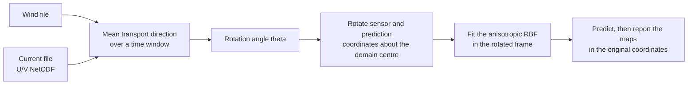

The orientation angle theta comes from separate wind or current data, not from the concentration
ground truth. This is a transport-oriented covariance, not a PDE-constrained GP.

---

## Thesis Roadmap

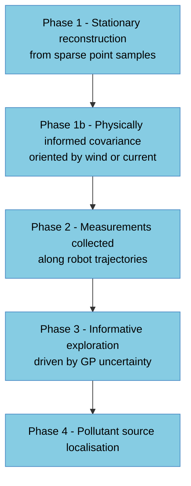


Static reconstruction and random-walk trajectory sampling are implemented. Informative planning
and source localisation are the next stages, not capabilities demonstrated by the current results.

---

## Current Status

Implemented:

- NetCDF dataset loading and layout validation with `xarray`;
- extraction of a single time snapshot and valid-domain detection from finite values;
- synthetic sensor sampling on valid marine cells, without replacement, with optional noise;
- GP fitting with isotropic or anisotropic RBF kernels, plus `ConstantKernel` and `WhiteKernel`;
- **coordinate rotation informed by an external forcing**, from a wind time series or from a
  current U/V NetCDF file, with a configurable averaging window;
- full-field reconstruction on the original grid, with batched prediction;
- predictive uncertainty maps and error metrics: MSE, RMSE, MAE, R2;
- single-seed and multi-seed sample-size studies;
- **multi-seed comparison of four covariance structures** — isotropic, axis-aligned anisotropic,
  wind-informed and current-informed — on identical shared samples;
- positivity diagnostics, `log1p` and `sqrt` transforms with moment-corrected predictions,
  and a paired Direct/clipping versus sqrt control over 20 seeds;
- length-scale bound diagnostics, reporting how often an optimised length scale reaches its bound;
- **peak diagnostics** at a fixed sensor budget: prediction at the true maximum, localisation error
  and local RMSE inside a peak-centred disk, with a zoom and two directional profiles;
- **oracle sampling controls** — peak-observed and locally enriched — that redistribute sensors
  without changing their number, and are evaluated on cells observed by no configuration;
- **single versus two-scale kernel comparison**, with prescribed initialisations selected by
  marginal likelihood on the sensors alone;
- controlled optimiser diagnostics: initialisation study, nested restart study, and lower-bound,
  upper-bound and local sensitivity studies for the length scales;
- **mobile sampling on a frozen field:** 20 robots, 40 acquisitions and three initial deployments,
  studied over 100 seeds, with checkpoint maps and GIFs;
- matched uniform references, a cross-deployment Pure Uniform comparison, and geometric
  proximity and step-length diagnostics;
- NetCDF inspection utilities.

---

## Key Result

In the tested scenario, a **transport-oriented covariance** improves reconstruction over the
isotropic and axis-aligned references.

Averaged over five random seeds on the `CL02_V1_SRC131` scenario at time index 729, with identical
samples shared by all four models and a length-scale lower bound of 0.075:

| Sensors | Isotropic | Axis-aligned | Wind-informed | Current-informed |
|---:|---:|---:|---:|---:|
| 200 | 0.2582 | 0.2589 | 0.1998 | **0.1983** |
| 400 | 0.2411 | 0.2425 | 0.1702 | **0.1568** |
| 800 | 0.1977 | 0.1909 | 0.1439 | **0.1356** |
| 1200 | 0.1739 | 0.1739 | **0.1240** | 0.1243 |
| 1600 | 0.1635 | 0.1635 | 0.1271 | **0.1248** |

Mean RMSE on the valid marine cells; lower is better. At 1200 and 1600 sensors, both axis-aligned
length scales reach the imposed lower bound, making its RBF component isotropic. The overlap is
therefore a constrained-fit result, not proof that axis-aligned anisotropy never helps.
Wind- and current-informed models improve the mean RMSE in this experiment; this is not a universal
ranking of physical forcings or a universal recommendation for the bound 0.075.

Controlled optimiser studies also found strong dependence on initialisation. At N=800, seed 123,
short-scale initialisation reached LML about -865.518 versus -977.843 from Default. Neither of two
sequences of seven random restarts recovered that higher-LML basin. It is the best-known solution
within those controlled tests, not a proven global optimum. LML is fitted on sensors; full-grid
RMSE is a separate simulation diagnostic and is never used to choose the fitted candidate.

---

## Results Snapshot

A small number of curated figures. Diagnostic panels are discussed in the report, not here.

### Valid Marine Domain

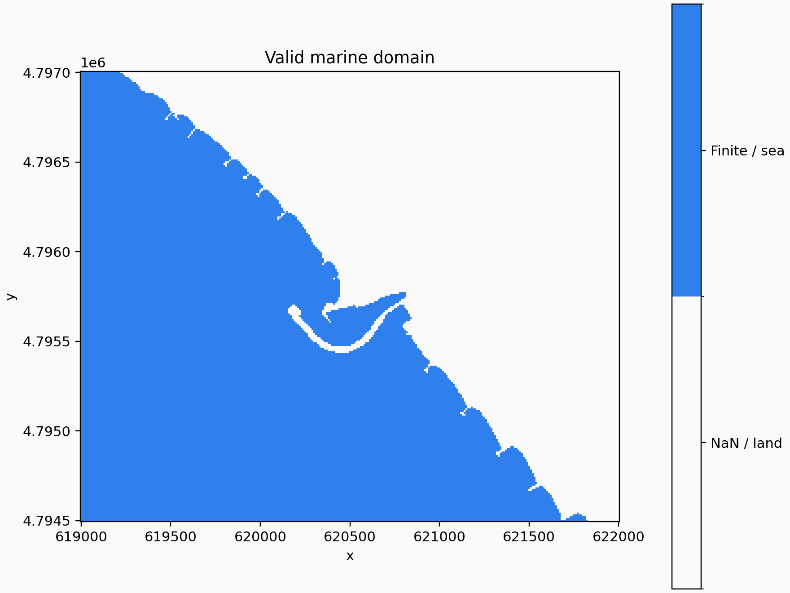

The valid domain is extracted from finite concentration values. Sampling, reconstruction and metric
computation are all restricted to these cells.

### Stationary Reconstruction Example

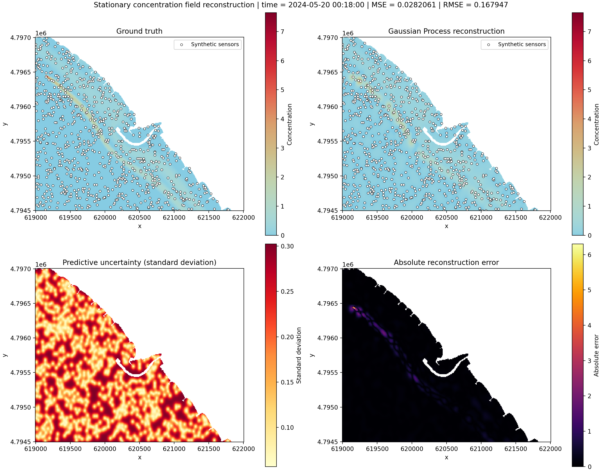

Single-run reconstruction of `CL02_V1_SRC131` at time index `729` with 800 synthetic sensors
and an axis-aligned anisotropic RBF kernel. The four panels show ground truth, the GP mean,
predictive standard deviation and absolute error. The thin filament motivates the transport-oriented
models and local sampling studies below.

### Multi-Seed Sample-Size Study

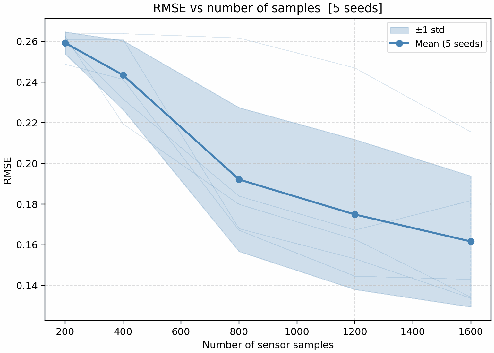

On the same `CL02_V1_SRC131` snapshot, the multi-seed study compares 200, 400, 800, 1200 and
1600 sensors. Unlike the single reconstruction above, this figure summarises variability across
sampling seeds. Mean RMSE decreases as coverage increases, with diminishing gains; the spread
shows that reconstruction also depends on where the sensors fall relative to the filament.

### Kernel Comparison

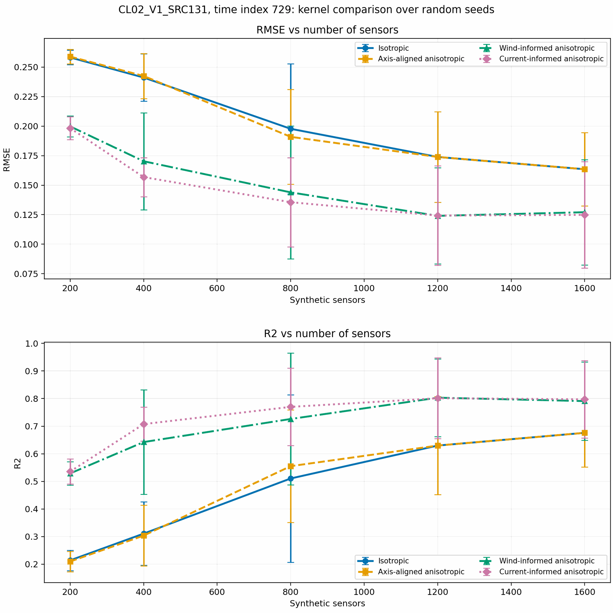

The four covariance structures on shared samples. The isotropic and axis-aligned curves overlap; the
two physically informed curves separate clearly from them.

---

## Recovering the Peak

Controlled experiments on `CL02_V1_SRC131` (time index 729, 800 sensors) show how local sampling
and a flexible current-informed GP can improve both peak recovery and field reconstruction.

`--peak-diagnostics` complements global metrics with peak height, location and error within a
150 m disk. These diagnostics reveal local details that a low global RMSE can hide.

### Improving Local Coverage

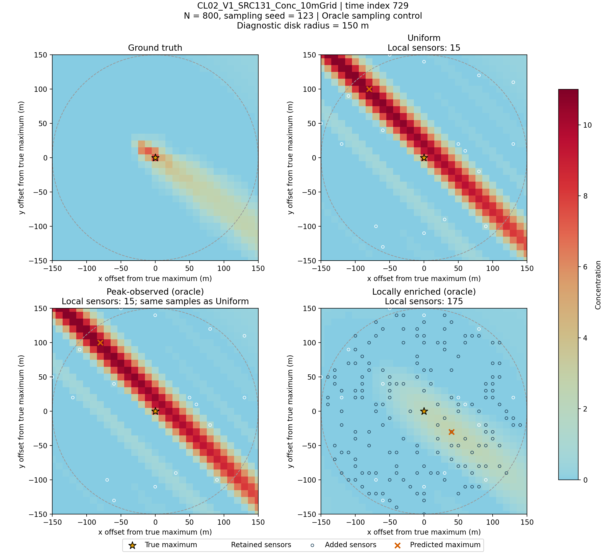

`--peak-sampling-study` compares uniform, peak-observed and locally enriched layouts at a
**fixed budget of 800 sensors**. Moving 160 sensors into the disk reduces local RMSE on common
unobserved cells from **2.94 to 0.50** for seed 123 and **0.47 to 0.39** for seed 7.
This improves the neighbourhood reconstruction, while motivating a closer look at peak height.

### Recovering the Peak with Finer Scales

`--peak-kernel-study` compares single and two-scale RBF kernels, selecting the best converged fit
from two prescribed initialisations by sensor marginal likelihood. With enriched sampling,
lowering the length-scale bound from 0.05 to 0.02 substantially improves peak recovery:

| Seed 123, enriched | Lower bound | Prediction at the true peak | Local unseen RMSE |
|---|---:|---:|---:|
| Single RBF | 0.05 | 2.975 | 0.448 |
| Single RBF | 0.02 | **7.280** | 0.269 |
| Two RBFs | 0.05 | 3.161 | 0.444 |
| Two RBFs | 0.02 | **7.381** | 0.278 |

The two-scale model recovers **96.5% of the true peak** (7.647) for seed 123 and **81.2%** for
seed 7. At the same bound of 0.02, it also reduces global RMSE on common unobserved cells by
approximately **29% and 34%**, respectively, compared with the single RBF.

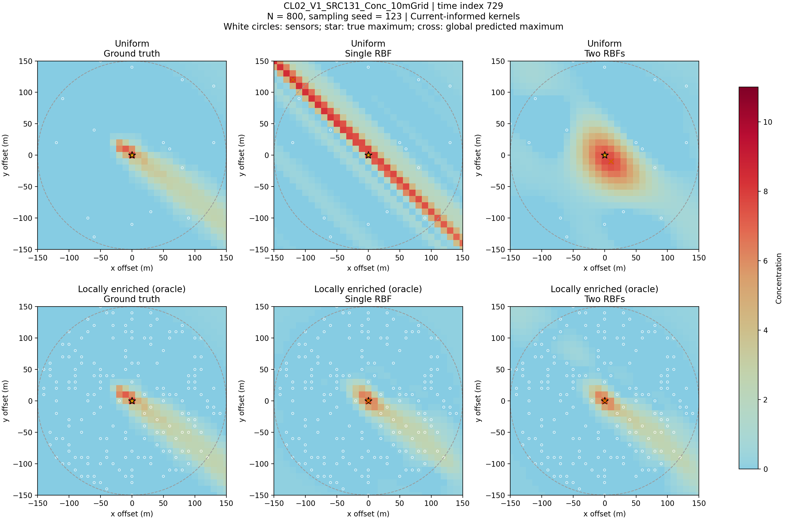

Ground truth, single RBF and two RBFs at lower bound 0.02. Rows show uniform and enriched sampling,
with a shared colour scale.

These results support combining local coverage with finer admissible scales and a two-scale
covariance. They concern two seeds and one snapshot: enrichment uses the known true peak
(*oracle* information), and a smaller bound does not improve every sampling configuration.
They demonstrate improved reconstruction, not autonomous source localisation.

---


## Positive Predictions

Clipping, moment-corrected `log1p` and moment-corrected square-root predictions were compared
on matched observations. The follow-up control isolates **Direct + clipping (D)** versus **sqrt (Q)**
over seeds 1-20, N=800, with the same two-scale kernel and bounds `[0.01, 100]`.
Each method selects its highest-LML converged fit from Broad/short and Compact/short initialisations.

| Sampling | D global RMSE | Q global RMSE | Seeds where Q wins |
|---|---:|---:|---:|
| Uniform | 0.1048 +/- 0.0173 | **0.0899 +/- 0.0131** | 19/20 |
| Locally enriched (oracle) | 0.1413 +/- 0.0224 | **0.1038 +/- 0.0108** | 20/20 |

Mean +/- sample standard deviation, on common unobserved cells within each seed.
Q improves global reconstruction, but improves the absolute peak-height error in only 8/20 Uniform
and 12/20 enriched cases. Separate diagnostics for `c=0`, `0<c<=1`, `c>1` and the local 150 m disk
prevent a good score on the clean background from hiding errors in the plume.
These bounds differ from the robot experiments below; this is not a direct ranking across studies.

## Robots

**From Sensors to Mobile Robots:**
the field remains frozen at CL02 time index 729. Twenty point-like robots collect 40 measurements
each (initial positions plus 39 movement attempts), giving **800 acquisitions, not necessarily 800
distinct cells**. The random walk uses a nominal 60 m step and valid-grid geometry. Repeated noiseless
observations are fitted once per distinct cell; no extra measurements are added to replace revisits.

Three deployments have equal standing in the comparison:

| Deployment | Initial positions | Prior information |
|---|---|---|
| Central | 20 robots in a 150 m disk around a geometry-derived centre | Marine mask only |
| Uniform-domain | 20 distinct random cells across the valid domain | Marine mask only |
| Peak-annulus | 3 robots in a 30-150 m annulus around the true maximum; 17 elsewhere | Oracle peak location |

The annulus excludes the peak cell at deployment. It represents a favourable initial condition:
as you can see at the start of the GIF below, three robots are placed near the true peak,
inside the 30-150 m annulus, but not on the peak cell itself. The animation then shows their
random walks, not a policy that has discovered or actively follows the source.

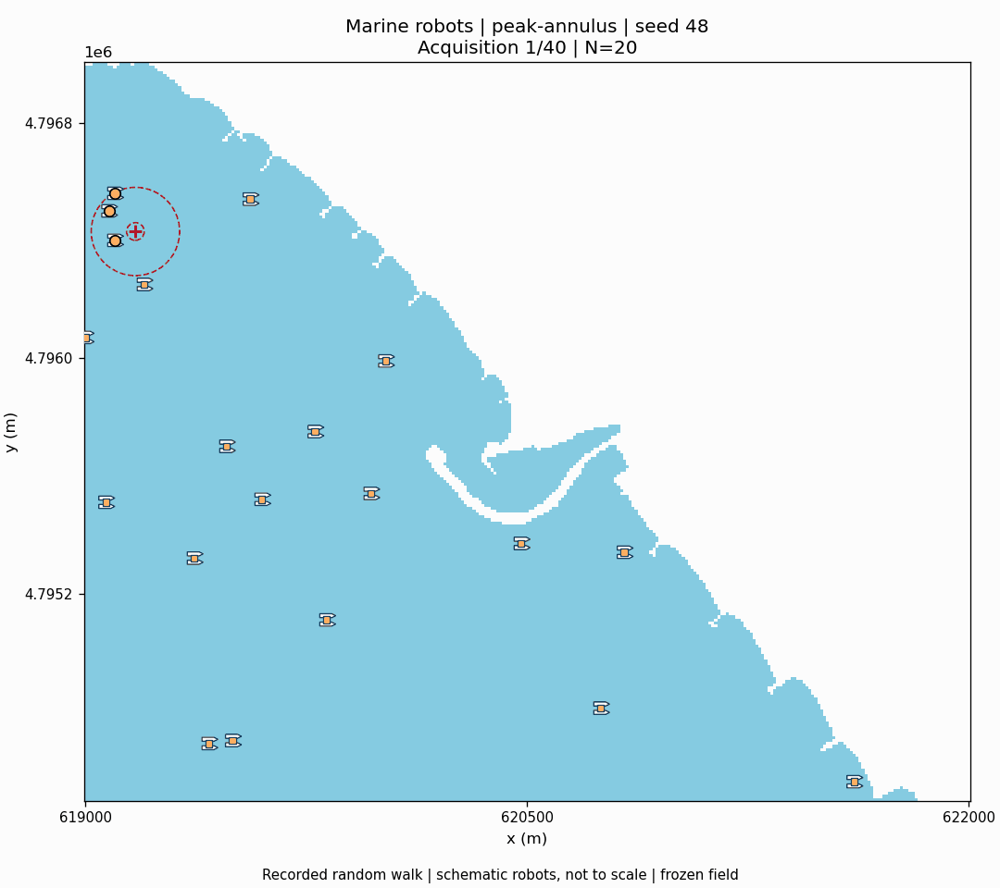

The central experiment models a compact release without
knowledge of the plume. 

All use two current-oriented RBF components, bounds `[0.02, 100]`, direct targets and clipping.
For every seed, checkpoint and layout, Broad/short and Compact/short are alternative initialisations
of the same model; the highest sensor-LML converged fit is selected.

### What the 100-seed comparison shows

Within each deployment, **Uniform budget** matches acquisition count and **Uniform distinct** matches
the number of distinct robot cells. Both inherit the robot starts; nested samples and a fixed common
unobserved evaluation mask make checkpoints comparable within a seed.

For the direct comparison below, a separate **Pure Uniform** reference inherits no robot starts.
All four strategies are evaluated on exactly the same spatial domains: the full valid grid and the
full 150 m peak disk, **including observed cells**. These scores must not be confused with the earlier
common-unobserved errors.

| At 800 acquisitions, 100 seeds | Central | Uniform-domain | Peak-annulus (oracle) | Pure Uniform |
|---|---:|---:|---:|---:|
| Global RMSE | 0.2409 +/- 0.0135 | 0.1968 +/- 0.0586 | 0.1825 +/- 0.0270 | **0.1248 +/- 0.0224** |
| Local RMSE | 0.9185 +/- 0.0113 | 0.8075 +/- 0.2989 | **0.5635 +/- 0.1506** | 0.7172 +/- 0.1685 |
| Distinct sampled cells (mean) | 700.9 | 713.4 | 712.1 | 800.0 |
| Distinct sampled cells in peak disk (mean) | 0.00 | 15.87 | 53.02 | 14.17 |
| Prediction at true peak (mean; truth = 7.647) | 0.268 | 1.732 | 3.409 | 1.704 |

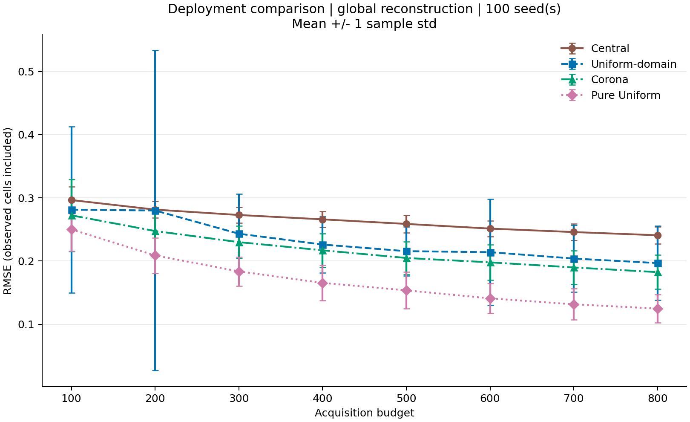

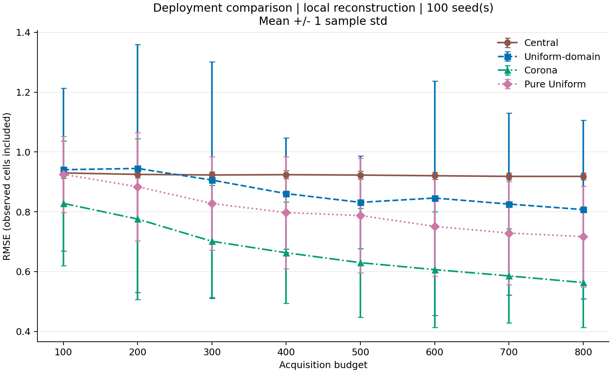

Bars show one sample standard deviation across seeds. Pure Uniform gives
the best mean global coverage, but is not a feasible motion policy for the same robots without travel
constraints. The annulus gives the best mean local reconstruction, using privileged initial information.
The central release misses the diagnostic disk in these runs. These results motivate **informative
trajectories that balance coverage and plume detail**, rather than claiming that random walks solve
source localisation. 

## Robot Animations

The following recorded runs illustrate the reconstruction of the filament at seed 48. 
The 100-seed results above provide the statistical context.

Each GIF shows ground truth with accumulated trajectories and robot positions, the latest GP mean,
and predictive standard deviation (including WhiteKernel). The GP is updated at checkpoints
100, 200, ..., 800; between fits, the previous reconstruction stays visible. 

### Central release

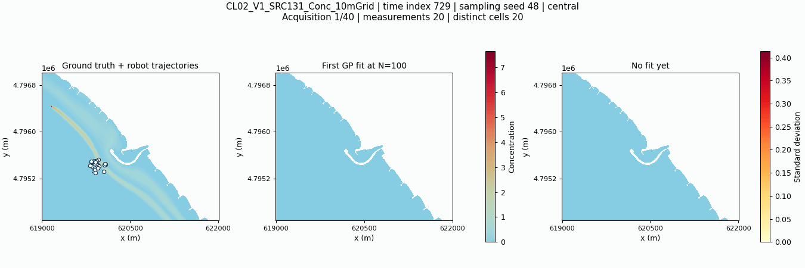

### Uniform-domain release

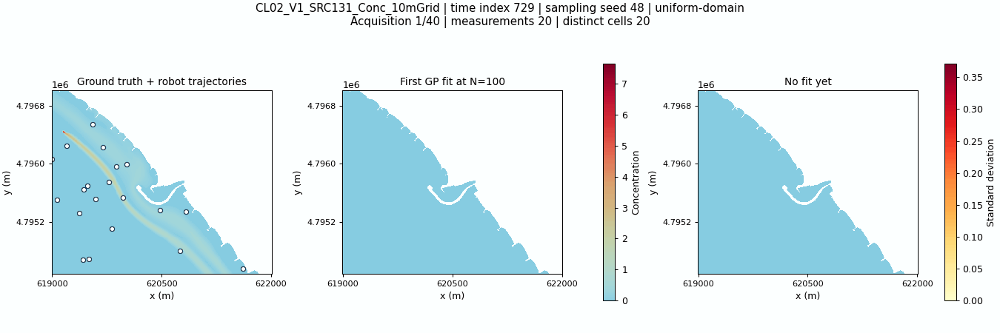

### Corona release

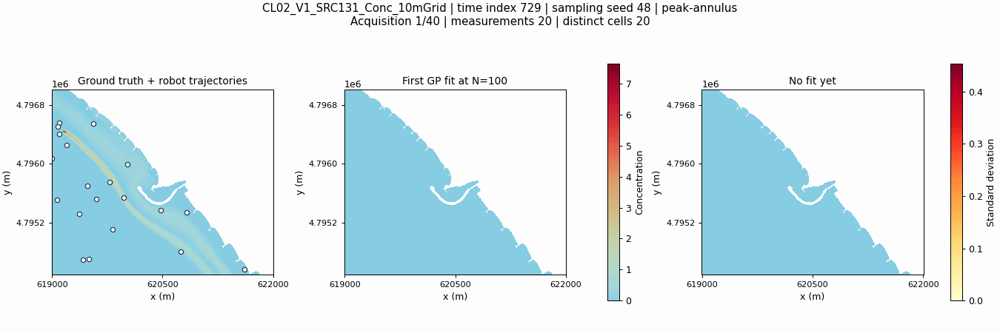

---

## Repository Structure

```text
main.py                     Entry point: parses arguments and runs the workflow
pollutant_gp/
  cli.py                    Command-line interface
  data.py                   NetCDF loading, validation and grid preparation
  inspection.py             NetCDF inspection utilities
  model.py                  Kernel construction, GP fitting, batched prediction
  reconstruction.py         Full-field reconstruction and error metrics
  sampling.py               Synthetic sensor sampling
  spatial.py                Coordinate rotation used by the physically informed models
  wind.py                   Wind time series parsing and transport direction
  current.py                Current U/V fields and mean transport direction
  peak.py                   Peak-centred metrics and the diagnostic disk
  peak_sampling.py          Oracle sampling controls at a fixed sensor budget
  peak_kernel.py            Single versus two-scale kernel comparison
  peak_visualization.py     Peak zooms and directional profiles
  positivity.py             Matched target-transform comparison
  positivity_multiseed.py    Paired Direct/clipping versus sqrt study
  robot/
    trajectories.py         Deployments, random walks and domain geometry
    study.py                Single-seed fitting, baselines and saved maps
    visualization.py        Robot maps, checkpoint panels and GIFs
    multiseed.py            Per-seed metrics and aggregate statistics
    deployment_comparison.py Archived Robot fits versus Pure Uniform
    proximity.py            Geometric inter-robot proximity diagnostics
    step_sensitivity.py     Controlled random-walk step-length study
  types.py                  Shared dataclasses
  style.py                  Shared palette and figure styling
  visualization.py          Plot generation
  workflow.py               Pipeline orchestration and experimental studies
outputs/                    Selected figures 

requirements.txt
README.md
```


---

## Installation

```bash
pip install -r requirements.txt
```

Recommended Python version: 3.10 or newer. Dependencies: `numpy`, `scipy`, `xarray`, `netCDF4`,
`scikit-learn`, `matplotlib`, `pillow`.

---

## Data

The project uses NetCDF simulation files produced with the MIKE 21 Flow Model FM for the waters
around the port of Cecina. Concentration files use:

```text
variable:    Concentration - component 1
dimensions:  time, y, x
coordinates: time, y, x
```

Velocity files carry `u_velocity` and `v_velocity` on the same grid and are used by the
current-informed model. Land and excluded cells are stored as `NaN`, so the navigable domain is
recovered from the data themselves:

```python
valid_mask = np.isfinite(field)
```

Large NetCDF files are ignored by Git. Keep them locally and pass their path with `--nc-file`.

---

## Usage

All commands are run from the repository root.

### Inspect the data

```bash
python main.py --nc-file CMEMS_S1_01_conc_grid_10m.nc --print-dataset --time-index 705
python main.py --inspect-netcdf --netcdf-dir .
```

### Standard reconstruction

```bash
python main.py --nc-file CL02_V1_SRC131_Conc_10mGrid.nc --time-index 729 --n-samples 200
```

### Physically informed reconstruction

Rotate the covariance along the wind-derived transport direction:

```bash
python main.py --nc-file CL02_V1_SRC131_Conc_10mGrid.nc --time-index 729 \
  --n-samples 800 --physically-informed
```

Or along the mean sea current, averaged over the twelve hours preceding the snapshot:

```bash
python main.py --nc-file CL02_V1_SRC131_Conc_10mGrid.nc --time-index 729 \
  --n-samples 800 --current-informed --current-average-hours 12
```

### Compare the four covariance structures

All models are evaluated on identical samples for every `(seed, N)` pair, so differences are
attributable to the model and not to the data:

```bash
python main.py --nc-file CL02_V1_SRC131_Conc_10mGrid.nc --time-index 729 \
  --kernel-comparison-study \
  --sample-size-study-counts 200 400 800 1200 1600 \
  --sample-size-study-seeds 7 42 123 256 512 \
  --length-scale-lower-bound 0.075
```

### Sample-size studies

```bash
python main.py --nc-file CMEMS_S1_01_conc_grid_10m.nc --time-index 2820 --sample-size-study-multiseed \
  --sample-size-study-counts 10 25 50 100 200 400 800 \
  --sample-size-study-seeds 7 42 123 256 512
```

### Positivity of the predictions

```bash
python main.py --time-index 729 --n-samples 800 --current-informed --target-transform none --clip-negative
python main.py --time-index 729 --n-samples 800 --current-informed --target-transform log1p
python main.py --time-index 729 --n-samples 800 --current-informed --target-transform sqrt
```


### Peak diagnostics and kernel study

Metrics and figures centred on the true maximum, after a single reconstruction:

```bash
python main.py --nc-file CL02_V1_SRC131_Conc_10mGrid.nc --time-index 729 \
  --n-samples 800 --current-informed --random-seed 123 --n-restarts 0 \
  --peak-diagnostics --peak-radius 150 --peak-vmax 11 --peak-coordinate-unit m
```

Uniform, peak-observed and locally enriched sensor layouts:

```bash
python main.py --nc-file CL02_V1_SRC131_Conc_10mGrid.nc --time-index 729 \
  --n-samples 800 --current-informed --random-seed 123 --n-restarts 0 \
  --peak-sampling-study --peak-radius 150 --peak-local-replacements 160 \
  --peak-vmax 11 --peak-coordinate-unit m
```

Single against two-scale kernel:

```bash
python main.py --nc-file CL02_V1_SRC131_Conc_10mGrid.nc --time-index 729 \
  --n-samples 800 --current-informed --random-seed 123 --n-restarts 0 \
  --peak-kernel-study --length-scale-lower-bound 0.02 \
  --peak-radius 150 --peak-local-replacements 160 \
  --peak-vmax 11 --peak-coordinate-unit m
```

---

### Reproduce the positivity control (20 seeds)

PowerShell; this launches fits, not just plotting:

```powershell
python main.py --nc-file CL02_V1_SRC131_Conc_10mGrid.nc --time-index 729 --n-samples 800 --current-informed --current-average-hours 12 --positivity-study-multiseed --positivity-study-seeds (1..20) --length-scale-lower-bound 0.01 --length-scale-upper-bound 100 --n-restarts 0 --peak-radius 150 --peak-local-replacements 160 --peak-coordinate-unit m --prediction-batch-size 2000 --output-dir outputs/positivity_20seeds
```

### Reproduce the seed 48 animations

Each command fits the three sampling layouts at all checkpoints and saves both GIFs.
The annulus inner radius and display threshold are explicit to match the illustrated runs.

```bash
python main.py --nc-file CL02_V1_SRC131_Conc_10mGrid.nc --time-index 729 --robot-study --robot-deployment central --robot-start-radius 150 --current-informed --current-average-hours 12 --random-seed 48 --n-robots 20 --n-steps 40 --robot-step 60 --length-scale-lower-bound 0.02 --length-scale-upper-bound 100 --n-restarts 0 --target-transform none --clip-negative --robot-map-style transparent --concentration-display-threshold 0 --robot-gif --peak-coordinate-unit m --output-dir outputs
```

```bash
python main.py --nc-file CL02_V1_SRC131_Conc_10mGrid.nc --time-index 729 --robot-study --robot-deployment uniform-domain --current-informed --current-average-hours 12 --random-seed 48 --n-robots 20 --n-steps 40 --robot-step 60 --length-scale-lower-bound 0.02 --length-scale-upper-bound 100 --n-restarts 0 --target-transform none --clip-negative --robot-map-style transparent --concentration-display-threshold 0 --robot-gif --peak-coordinate-unit m --output-dir outputs
```

```bash
python main.py --nc-file CL02_V1_SRC131_Conc_10mGrid.nc --time-index 729 --robot-study --robot-deployment peak-annulus --robot-near-count 3 --robot-annulus-inner 30 --robot-annulus-outer 150 --current-informed --current-average-hours 12 --random-seed 48 --n-robots 20 --n-steps 40 --robot-step 60 --length-scale-lower-bound 0.02 --length-scale-upper-bound 100 --n-restarts 0 --target-transform none --clip-negative --robot-map-style transparent --concentration-display-threshold 0 --robot-gif --peak-coordinate-unit m --output-dir outputs
```

### Robot studies over 100 seeds

These are substantial GP runs. Omitting `--robot-study-seeds` selects seeds 1-100;
`--random-seed 48` alone does not select the multi-seed sequence. No GIFs are generated here.

```bash
python main.py --nc-file CL02_V1_SRC131_Conc_10mGrid.nc --time-index 729 --robot-study-multiseed --robot-deployment central --robot-start-radius 150 --current-informed --current-average-hours 12 --length-scale-lower-bound 0.02 --length-scale-upper-bound 100 --peak-coordinate-unit m --figure-name robot_multiseed.png --output-dir outputs/robot_multiseed_100seeds
```

```bash
python main.py --nc-file CL02_V1_SRC131_Conc_10mGrid.nc --time-index 729 --robot-study-multiseed --robot-deployment uniform-domain --current-informed --current-average-hours 12 --length-scale-lower-bound 0.02 --length-scale-upper-bound 100 --peak-coordinate-unit m --figure-name robot_domain_multiseed.png --output-dir outputs/robot_domain_100seeds
```

```bash
python main.py --nc-file CL02_V1_SRC131_Conc_10mGrid.nc --time-index 729 --robot-study-multiseed --robot-deployment peak-annulus --robot-near-count 3 --robot-annulus-inner 30 --robot-annulus-outer 150 --current-informed --current-average-hours 12 --length-scale-lower-bound 0.02 --length-scale-upper-bound 100 --peak-coordinate-unit m --figure-name robot_annulus_multiseed.png --output-dir outputs/robot_peak_100seeds
```

After those archives exist, reproduce the comparison on common full domains:

```bash
python -m pollutant_gp.robot.deployment_comparison --output-dir outputs/robot_deployment_comparison_local
```

This reuses archived Robot hyperparameters without reoptimising them and predicts locally to
complete the common-domain scores; Pure Uniform is fitted separately. The default input paths
match the three commands above. Add `--resume` to this comparison command to skip completed seeds.

## Command-Line Arguments

| Argument | Default | Description |
|---|---:|---|
| `--nc-file` | `CL02_V1_SRC131_Conc_10mGrid.nc` | NetCDF file used for reconstruction |
| `--time-index` | auto | Time index to reconstruct or inspect |
| `--n-samples` | `200` | Number of synthetic sensors |
| `--noise-std` | `0.0` | Standard deviation of the simulated sensor noise |
| `--random-seed` | `7` | Seed for the main reconstruction |
| `--kernel-mode` | `anisotropic` | One length scale per axis, or a single shared one |
| `--physically-informed` | off | Rotate coordinates along a physical transport direction |
| `--physics-source` | `wind` | Forcing used for the rotation: `wind` or `current` |
| `--current-informed` | off | Shortcut for `--physically-informed --physics-source current` |
| `--wind-file` | `CI_WIND_faseII_V1.txt` | Wind forcing time series |
| `--wind-average-hours` | `12.0` | Averaging window preceding the snapshot |
| `--current-file` | `CL02_V1_SRC000_U_V_10mGrid.nc` | Current U/V dataset |
| `--current-average-hours` | `12.0` | Averaging window for the mean current |
| `--length-scale-lower-bound` | `0.05`; robot studies: `0.02` | Lower bound in standardised coordinates |
| `--length-scale-upper-bound` | `100.0` | Upper bound in standardised coordinates |
| `--target-transform` | `none` | `none`, `log1p`, `sqrt`; transformed predictions are moment-corrected |
| `--n-restarts` | `0` | Additional optimiser restarts |
| `--clip-negative` | on | Clip negative mean predictions to zero |
| `--allow-negative-predictions` | off | Keep negative predictions instead of clipping |
| `--prediction-batch-size` | `20000` | Grid points predicted per batch |
| `--sample-size-study` | off | Single-seed sample-size study |
| `--sample-size-study-multiseed` | off | Multi-seed sample-size study |
| `--kernel-comparison-study` | off | Multi-seed comparison of the four covariance structures |
| `--sample-size-study-counts` | `10 25 50 100 200 400 800` | Sample counts used by the studies |
| `--sample-size-study-seeds` | `7 42 123 256 512` | Seeds used by the multi-seed studies |
| `--peak-diagnostics` | off | Peak metrics, zoom and directional profiles after one reconstruction |
| `--peak-sampling-study` | off | Uniform, peak-observed and locally enriched oracle layouts at a fixed budget |
| `--peak-kernel-study` | off | Single against two-scale current-informed kernel on the same sensors |
| `--positivity-study` | off | Controlled comparison of target transforms |
| `--positivity-study-multiseed` | off | Paired D/Q study at N=800; 100 seeds by default |
| `--robot-study` | off | Single-seed robot experiment |
| `--robot-study-multiseed` | off | Robot study over seeds 1-100 unless specified |
| `--robot-deployment` | `uniform-domain` | `central`, `uniform-domain`, `peak-annulus` |
| `--robot-annulus-inner` | `50` | Set explicitly to `30` for the reported annulus experiment |
| `--robot-near-count` | `3` | Robots deployed in the oracle annulus |
| `--robot-step` | `60` | Nominal step in coordinate units (metres for CL02) |
| `--robot-gif` | off | Single-seed reconstruction and robot-motion animations |
| `--robot-map-style` | `quantitative` | Use `transparent` for the illustrated concentration maps |
| `--peak-radius` | `150.0` | Radius of the peak-centred diagnostic disk, in grid units |
| `--peak-local-replacements` | `160` | Outside sensors moved into the disk by the enriched control |
| `--peak-vmax` | auto | Common colour maximum for peak zooms, so runs stay comparable |
| `--peak-coordinate-unit` | auto | Unit label for the peak figures; no conversion is applied |
| `--optimizer-seed` | sampling seed | Seed used only for optimiser restarts |
| `--optimizer-initialization-study` | off | Four deterministic kernel initialisations on one shared sample |
| `--optimizer-restart-study` | off | Nested restart study, evaluating every internal optimiser run |
| `--length-scale-lower-bound-study` | off | Controlled sensitivity study over length-scale lower bounds |
| `--length-scale-upper-bound-study` | off | The same for upper bounds, on two initialisations |
| `--length-scale-local-sensitivity-study` | off | One-at-a-time perturbations around the short-scale solution |
| `--output-dir` | `outputs` | Directory where figures are saved |
| `--figure-name` | auto | Custom name for the main figure |
| `--show` | off | Show figures interactively as well as saving them |

For the complete list:

```bash
python main.py --help
```

---


## Outputs


A reconstruction produces a combined overview plus the same four panels saved separately, so that a
single map can be reused in a report or a slide without cropping:

| File | Content |
|---|---|
| `<base>.png` | four-panel overview |
| `<base>_ground_truth.png` | simulated concentration field |
| `<base>_gp_reconstruction.png` | GP posterior mean |
| `<base>_predictive_uncertainty.png` | predictive standard deviation |
| `<base>_absolute_error.png` | absolute error against the ground truth |

`<base>` is built from dataset name, time index, sample count and timestamp, and can be replaced
with `--figure-name`.

The studies write their own curves. The sample-size studies plot RMSE, MAE and R2 against the number
of sensors, with one faint line per seed and the mean in bold in the multi-seed version;
`--kernel-comparison-study` plots the same metrics with one curve per covariance structure.

Results are saved locally in the `outputs/` directory.
Robot single-seed runs also save checkpoint maps, local zooms, CSV diagnostics and NPZ fields;
`--robot-gif` adds reconstruction and movement GIFs. Multi-seed runs save per-seed metrics and
aggregate summaries/curves, without generating all per-seed GIFs. The curated README assets are
copies of existing results.


